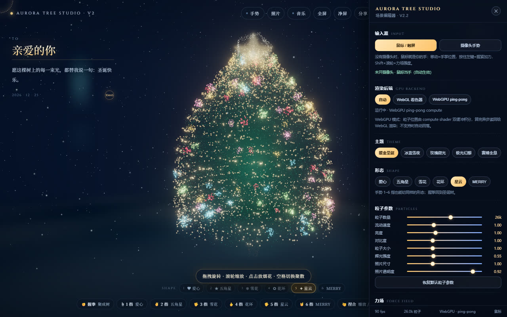
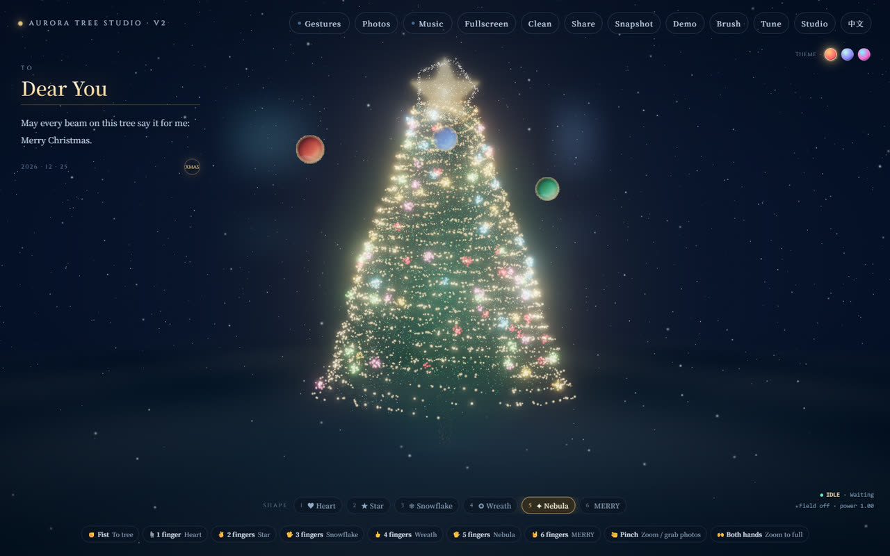

<div align="center">
  
</div>

<h1 align="center">🎄 Aurora Tree Studio <sub>V2.2</sub></h1>

<p align="center">
  Shape 26,000 stardust particles into a breathing Christmas tree — with camera gestures or just your mouse.<br>
  Runs in the browser. No driver wrangling, no setup.
</p>

<p align="center">
  <a href="https://2766792840.github.io/christmas-tree-gesture/"></a>
  <a href="https://github.com/2766792840/christmas-tree-gesture/releases/tag/v2.2.0"></a>
  <a href="https://github.com/2766792840/christmas-tree-gesture/actions/workflows/ci.yml"></a>
</p>

<p align="center">
  
  
  
  
  
  
</p>

<p align="center">
  <a href="README.md">中文</a> · <b>English</b> · <a href="https://2766792840.github.io/christmas-tree-gesture/">Live demo</a> · <a href="legacy/v1/">V1 archive</a>
</p>

---

## 🎬 Eight seconds first

<p align="center">
  
</p>

<p align="center"><sub>One mouse circle: the force field drags particles away, and they spring back into the tree when you let go. Real recording, not a motion edit.</sub></p>

## ✨ What you can play with

- 🖐 **Gestures or mouse, your pick**: with a camera, raise a hand; without one, the mouse becomes your hand — move the pointer to steer the force-field center, hold the left button to "clench" and multiply field strength by 1.45.
- 🪄 **26,000 particles**: not a texture — GPU point sprites, each with its own seed, colour, size and return spring.
- 💛 **Six shapes**: heart, star, snowflake, wreath, nebula, MERRY — hit `1`–`6` or raise 1–6 fingers and the particles fall into the new shape by themselves.
- 🖼 **Photo memory orbs**: drop photos in and let them orbit the tree as planets; tweak size, opacity, per-photo visibility.
- 🖌 **3D ink**: draw glowing strokes in space, and erase them.
- 🎛 **A full scene editor**: theme, shape, particle parameters, force field, layers, presets, export — one drawer.
- 📦 **Take it with you**: PNG snapshot or an 8-second WebM recording.
- 🌐 **Bilingual**: one `EN / 中文` toggle, remembered in localStorage.

## 📸 UI and shapes

<table>
  <tr>
    <td align="center"><br><sub><b>Heart</b> · 1 finger</sub></td>
    <td align="center"><br><sub><b>Star</b> · 2 fingers</sub></td>
  </tr>
  <tr>
    <td align="center"><br><sub><b>Scene editor</b> · input / backend / theme / particles / field</sub></td>
    <td align="center"><br><sub><b>English UI</b> · same scene, labels and gesture bar follow</sub></td>
  </tr>
</table>

<p align="center">
  <br>
  <sub>📱 Portrait phones: the camera pulls back with the screen ratio so the whole tree stays in frame</sub>
</p>

## 🧠 How it runs

Rendering still goes through three.js WebGL; WebGPU only integrates particle physics — so materials never had to be rewritten as TSL nodes, while the compute path still gets used.

- `PingPongParticles` in `src/webgpu/compute.ts` holds three storage buffer groups — `base` (target position + seed, vec4), `posA/posB`, `velA/velB` — with two bind groups pointing at each other and alternating every frame: that is the ping-pong.
- The WGSL kernel runs per frame: spring return to the target shape (so particles fall back after a shape switch), palm repulsion / attraction (per-seed reach, attraction keeps a spherical shell), vortex, pulse shock wave, exponential damping.
- Results are `copyBufferToBuffer`-ed into a staging buffer, read back asynchronously via `mapAsync`, packed into vec3 and fed to the `aPhys` vertex attribute; when `uGpu > 0.5` the shader uses `aPhys` as the position and bypasses the built-in force-field block.
- Backend arbitration lives in `src/core/backend.ts`: desktop + WebGPU available means auto-on; mobile, no WebGPU, or `?gpu=0` falls back to the WebGL2 shader force field. The editor's "GPU backend" group switches manually, and the HUD shows the live backend.
- Measured on an Intel Gen-12lp iGPU with 26k particles: ~45–47 fps on WebGPU, ~46 fps on WebGL2 — no visible drop when switching.

## 🚀 Run it locally

```bash
cd app
npm install
npm run dev        # http://127.0.0.1:8782
npm run typecheck  # tsc --noEmit
npm run test       # vitest, 17 cases
npm run build      # output in app/dist/
npm run preview    # preview the build (8783)
npm run ci         # typecheck + test + build — exactly what CI runs
```

After changing sources, copy `app/dist/index.html` and `app/dist/assets/` over the repository root to publish. The build output needs no import map and can be dropped into any static host.

To regenerate the screenshots and GIF used here:

```bash
cd app
npm run build && npx vite preview --port 8783   # in another terminal
node scripts/capture.mjs                         # writes ../docs/screenshots/
```

## 🧪 Tests and CI

<p>
  
  
  
</p>

`src/core/*.test.ts` covers the three pieces of pure logic most likely to fail silently: backend arbitration, NDC mapping and intensity stepping, preset normalization and round-trip serialization.

<details>
<summary>🧷 What the 17 unit tests and 6 E2E tests actually assert</summary>

- `backend.test.ts` (4): manual / auto / no-GPU / mobile arbitration results and their reason strings.
- `pointer.test.ts` (7): NDC mapping (center, corners, out-of-range clamping, zero-size never yields Infinity), intensity stepping and 0–2 clamping.
- `presets.test.ts` (6): preset normalization, bad JSON / array input returning null, serialize round-trip.
- E2E locks no pixel baseline (every GPU draws differently); instead: screenshot is not black, switching shape moves more than 2% of pixels, zero `pageerror` / console errors / WebGPU `used in submit while mapped` warnings; plus `?gpu=0` must fall back to WebGL2, language switching persists in localStorage, and with a WebGPU adapter the backend must be ping-pong (auto-skipped on GPU-less CI).

</details>

`.github/workflows/ci.yml`: on push to main, PRs and manual dispatch; Node 22, `npm ci`, typecheck, test, build, then Playwright E2E, uploading `playwright-report/` and `test-results/` on failure.

## 🗂 Repository layout

```
index.html          # the live page (already built; GitHub Pages reads this)
assets/             # built js / css
app/                # the Vite + TypeScript project; develop and build here
legacy/v1/          # archived single-file V1
docs/screenshots/   # README images and GIF, generated by app/scripts/capture.mjs
```

```
app/index.html              # DOM / styles only, no more 3000 lines of inline script
app/src/main.ts             # boot: mount editor → attach pointer hand → probe camera
app/src/app/engine.ts       # render core (three.js scene, particles, shaders, gesture FSM, export)
app/src/webgpu/compute.ts   # WebGPU ping-pong particle physics (WGSL kernel)
app/src/types/aurora.ts     # public engine API contract (window.__aurora)
app/src/core/presets.ts     # preset normalize / parse / serialize
app/src/core/pointer.ts     # NDC mapping, force-field intensity stepping
app/src/core/backend.ts     # backend arbitration: auto / webgl / webgpu
app/src/core/pointerHand.ts # "mouse as a hand" when there is no camera
app/src/ui/editor.ts        # scene editor (mutates the scene only via window.__aurora)
app/src/ui/i18n.ts          # zh/en dictionary + phrase rules + language detection
app/src/ui/langDom.ts       # DOM text-node translation, language toggle, dynamic-content observer
app/src/dev/errorScreen.ts  # runtime errors rendered on screen
```

**Layering**: the engine owns Three.js exclusively; the editor only calls semantic `window.__aurora` APIs (`setTheme` / `setShape` / `tune` / `setField` / `photos` / `layers` / `preset` / `snapshot` / `record`); the input layer only writes normalized coordinates, leaving world-space conversion to the engine's `screenToWorld`.

## ⌨️ Without a camera

| Input | Effect |
| --- | --- |
| Move the pointer | Palm position (the force-field centre) |
| Hold the left button | Clench, field intensity ×1.45 |
| `Shift` + wheel | Adjust field intensity (auto-switches to attraction when the field is off) |
| `1`–`6` | Six shapes |
| `G` | Cycle the force field |
| Space | Pulse shock wave |
| `E` | Toggle the editor |

**URL parameters**: `?field=1|2|3` (repel/attract/vortex), `?fieldSim=1` (auto-touring field), `?gpu=0` (force WebGL), `?demo=1` (demo photos), `?shape=heart|star|flake|wreath|nebula|merry`, `?lang=en|zh`, `?debug=1`.

## 🎛 Full editor capabilities

<details>
<summary>Expand the group list</summary>

| Group | Contents |
| --- | --- |
| Input | Mouse / touch ↔ camera gestures, auto-detects a missing camera and switches to mouse mode |
| GPU backend | Auto / WebGL shader / WebGPU ping-pong + live status |
| Theme | Warm gold / Ice blue / Rose glow / Aurora fantasy / Cyber hologram |
| Shape | Heart / Star / Snowflake / Wreath / Nebula / MERRY (same as 1–6 fingers) |
| Particles | Count, flow, brightness, contrast, size, glow, photo size, photo opacity |
| Force field | Off / repel / attract / vortex + intensity + pulse shock wave + demo animation |
| Photos | Thumbnail list, per-photo hide/show, delete, add (multi-select) |
| Layers | Tree, topper star, halo, photos, starfield, snow, aurora, galaxy haze, ground, snow ground, ink, fireworks |
| Presets | Save locally, load, export JSON, import JSON, paste JSON to apply |
| Export | PNG snapshot, 8-second WebM recording |

</details>

## 📌 Not done yet — stated, not faked

- Grabbing photo orbs with a mouse drag: photo grabbing still needs hand keypoints.
- A pure WebGPU render pipeline: currently compute + readback + WebGL rendering; materials are not moved to TSL.
- Splitting `engine.ts` into modules and filling in internal types: the outward surface is pinned by `AuroraApi`, but inside it is still `@ts-nocheck` as a whole.
- Pixel-locked visual regression: only machine-independent assertions today, no hard baseline.

## 📄 License

MIT © 2026 2766792840 · The old single-file page is kept in [`legacy/v1/`](legacy/v1/) and does not affect the live site.

<p align="center"><sub>🎄 If this tree lit something up for you, a ⭐ keeps it glowing.</sub></p>
