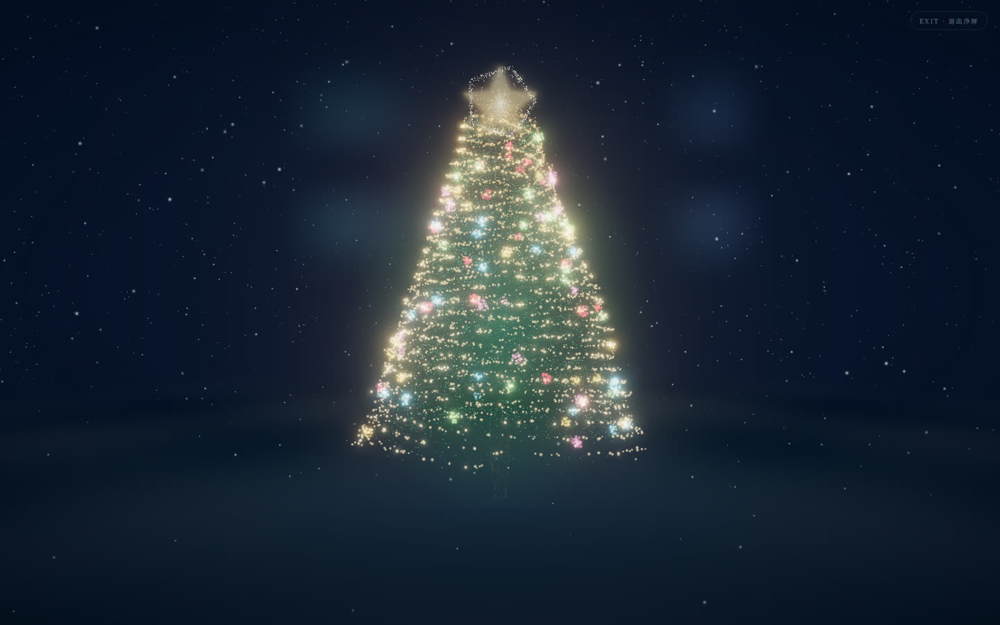
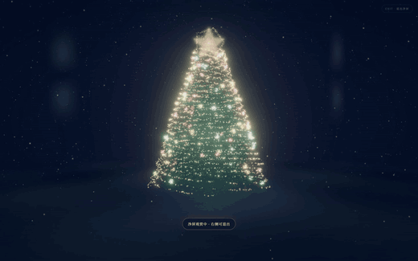
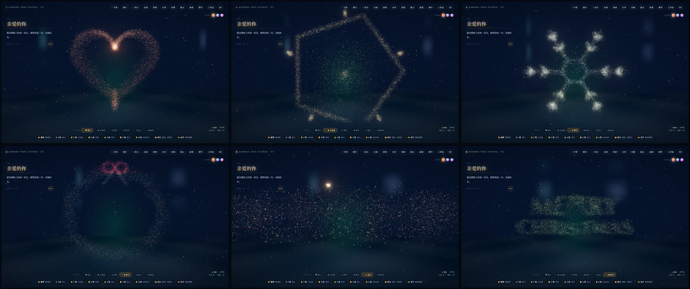
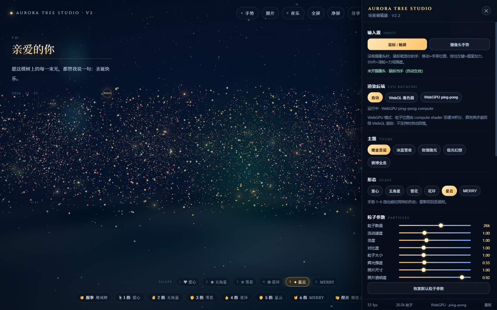
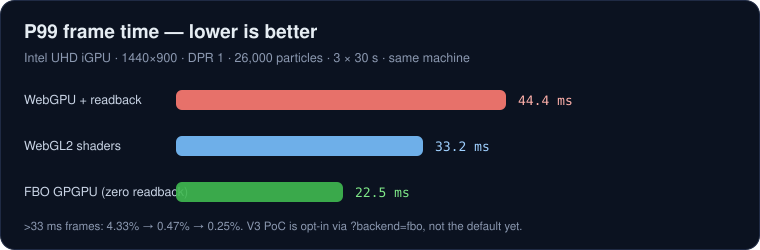
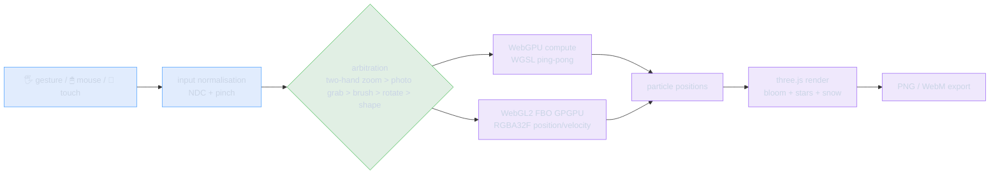

<div align="center">

# 🎄 Aurora Tree Studio

**Let the scattered light gather into a tree.**

A gesture- / mouse-driven 3D particle Christmas tree studio · 26,000 particles · WebGPU compute + WebGL2 backends
Photo orbs · 3D particle brush · scene editor · PNG / WebM export · bilingual UI

[**🕹 Live demo**](https://2766792840.github.io/christmas-tree-gesture/) ·
[中文](README.md) ·
[Benchmarks](app/docs/BENCHMARK.md) ·
[Gesture pipeline](app/docs/GESTURE.md)

<!-- Row 1: status and headline numbers -->
[](https://github.com/2766792840/christmas-tree-gesture/actions)
[](https://2766792840.github.io/christmas-tree-gesture/)
[](https://github.com/2766792840/christmas-tree-gesture/releases)
[](LICENSE)
[](#-measured-performance)
[](#-stack)

<!-- Row 2: stack -->


<!-- Row 3: quality -->
[](#-quality)
[](#-quality)
[](#bilingual-ui)

<a href="https://2766792840.github.io/christmas-tree-gesture/">
  
</a>

</div>

## ✨ What is this

A Christmas tree made of **26,000 particles**. Raise your hand and it follows you. Sweep the mouse and the light scatters. Make a fist and the tree collapses back.

It is not a single-file demo: Vite + TypeScript, 25 unit tests, 6 Playwright E2E specs, CI and GitHub Pages fully automated.

## 🎬 30 seconds

<div align="center">
  
  <br>
  <sub>Clean mode · the mouse acts as a hand, orbiting the tree so the particles scatter and fall back</sub>
</div>

## 🖐 Gesture cheat sheet

Just show your hand to the camera — or skip the camera entirely and use mouse / touch:

| Gesture | Command | Effect |
| :--: | --- | --- |
| ✊ Fist | Collapse | Particles return to the tree from any shape |
| ☝️ Index | Heart | Also fires a firework burst |
| ✌️ Two fingers | Star | A star blooms in the tree |
| 🖖 Three fingers | Snowflake | Forms a six-arm snowflake |
| 🖐 Four fingers | Wreath | Wraps into a ring |
| 🖐 Five fingers | Galaxy | Scatters into a nebula |
| 🤘 Thumb + pinky | MERRY | Spells MERRY |
| 👌 OK | Wish / finish | Creates a photo wish orb; ends brush mode |
| 🤏 Pinch | Zoom | Pinch distance dollies the camera, grabs photo orbs |
| 🙌 Two hands | Double-hand zoom | Distance between hands sets camera distance |

> Pipeline: MediaPipe 21 landmarks → One Euro adaptive filter → hysteresis state machine. Thresholds and what is still unverified live in [GESTURE.md](app/docs/GESTURE.md).

## 🎨 Six shapes

<div align="center">
  
  <br>
  <sub>Heart · Star · Snowflake · Wreath · Galaxy · MERRY　(keyboard 1–6 or 1–6 fingers)</sub>
</div>

## 🌈 Five themes

<div align="center">
  
  <br>
  <sub>Ice · Rose · Cyber (plus Classic gold and Aurora)</sub>
</div>

## 🛠 Studio: editable and saveable

<table>
<tr>
<td width="62%"></td>
<td width="38%" valign="top">

- 🎛 Input: mouse ↔ webcam gestures
- 🖥 Backend: auto / WebGL / WebGPU ping-pong / FBO GPU-resident
- 🎨 Theme, shape, particle count and flow speed
- ✨ Brightness, contrast, size, bloom, photo opacity
- 🌀 Force field: repel / attract / vortex + shockwave pulse
- 💾 Presets: save, export / import JSON
- 🖼 PNG snapshot · 🎥 8-second WebM recording

</td>
</tr>
</table>

## 📱 Works on phones

<table>
<tr>
<td width="30%"></td>
<td valign="top">

- Touch is the hand: drag to move the force field, pinch to zoom
- Mobile drops particle count and skips WebGPU, using the WebGL2 shader force field
- Toolbar, brush bar and palette do not overlap at 390 px width
- `viewport-fit=cover` plus safe-area padding keeps buttons clear of the notch

</td>
</tr>
</table>

## ⚡ Measured performance

<div align="center">
  
</div>

| Backend | P50 | P95 | P99 | Frames >33 ms | Readback |
| --- | :--: | :--: | :--: | :--: | :--: |
| WebGPU ping-pong + serial readback (default) | 22.1 ms | 30.9 ms | 44.4 ms | 4.33% | ~10.8 Hz |
| WebGL2 shader force field (control) | 22.1 ms | 22.4 ms | 33.2 ms | 0.47% | none |
| **WebGL2 FBO GPGPU (`?backend=fbo`)** | **22.1 ms** | **22.3 ms** | **22.5 ms** | **0.25%** | **none** |

<sub>Intel UHD iGPU · 1440×900 · DPR 1 · 26,000 particles · 3 × 30 s · same machine. 22.1 ms is close to 45 FPS, **not 60 FPS**; FBO just removes the tail, and only one device has been measured so far.</sub>

> This came from experiments, not guesses: an 8-slot staging ring pushed readback to 45 Hz but once froze the driver for 4.7 s; throttling to 20 Hz made P95 worse. The final answer was to revert to serial readback + vertex interpolation and move particle positions into a floating-point texture (FBO GPGPU), taking P99 from 44.4 ms to 22.5 ms. Rejected designs and raw data are in [BENCHMARK.md](app/docs/BENCHMARK.md).

## 🧩 Stack



| Layer | Location | Responsibility |
| --- | --- | --- |
| Engine | `src/app/engine.ts` | Three.js scene, particle attributes, field uniforms, photo orbs, ink, export |
| Gesture | `src/core/oneEuro.ts` + `src/core/gestureController.ts` | Adaptive filter, hysteresis, candidate hold, lost-tracking reset (no `@ts-nocheck`) |
| GPU physics | `src/webgpu/compute.ts` / `src/webgl/fboParticles.ts` | WGSL ping-pong / resident FBO compute |
| Editor | `src/ui/editor.ts` | Mutates the scene only via `window.__aurora`, never touches Three.js |
| Contract | `src/types/aurora.ts` | Public API types |

## 🚀 Quick start

```bash
git clone https://github.com/2766792840/christmas-tree-gesture.git
cd christmas-tree-gesture/app
npm install
npm run dev        # http://127.0.0.1:8782
npm run test       # 25 unit tests
npm run e2e        # 6 Playwright specs
npm run build      # output in dist/
```

| Command | Purpose |
| --- | --- |
| `npm run typecheck` | `tsc --noEmit`, strict mode |
| `npm run ci` | typecheck + test + build, same as CI |
| `npm run e2e` | starts preview and runs 6 visual / behavioural checks |

**Useful URL params**

| Param | Effect |
| --- | --- |
| `?backend=fbo` | GPU-resident particles (zero readback, PoC) |
| `?gpu=0` | Force WebGL2 shader force field |
| `?field=1\|2\|3` | Repel / attract / vortex |
| `?shape=heart\|star\|flake\|wreath\|galaxy\|text` | Pick a shape |
| `?lang=en\|zh` | Force language |
| `?bench=1` | Enable the sampling bridge `window.__auroraBench` |
| `?interp=0` / `?oe=0` | Disable vertex interpolation / gesture filter (A/B) |

## 🗺 Roadmap

| Stage | Work | Status |
| --- | --- | :--: |
| V2.2 | Vite + TS skeleton, layering, i18n, CI, E2E, Pages | ✅ |
| V3-P0 | Benchmark kit, diagnostic hooks, `benchmark.json` | ✅ |
| V3-P1a | Readback rework → rejected staging ring, added vertex interpolation | ✅ |
| V3-P1b | GPU-resident (WebGL2 FBO GPGPU), P99 44.4 → 22.5 ms | ✅ PoC |
| V3-P1c | One Euro + unified gesture FSM | ✅ implemented |
| V3-P2 | Split `engine.ts`, remove `@ts-nocheck` | 🚧 |
| V3-P2 | Device matrix: dGPU / Android / iOS / 30-minute soak | ⏳ |
| V3-P3 | Real hand-trajectory replay set to tune filter and thresholds | ⏳ |

## 🧪 Quality

- **25 unit tests**: backend arbitration, NDC mapping, preset normalisation, One Euro gesture controller (8 synthetic trajectories)
- **6 E2E specs**: boots clean, not a black screen, shape change is visible, `?gpu=0` fallback, language persistence, WebGPU backend
- **CI**: typecheck + test + build on push / PR, Pages auto-deploys
- **What we do not do**: no star farming, no view farming, no invented device data — anything unmeasured is labelled as unmeasured

## 📄 License

[MIT](LICENSE) · Built with Three.js, MediaPipe Tasks Vision and Vite

<div align="center">
  <br>
  <sub>⭐ If this tree reminds you of someone, a star is enough</sub>
</div>
