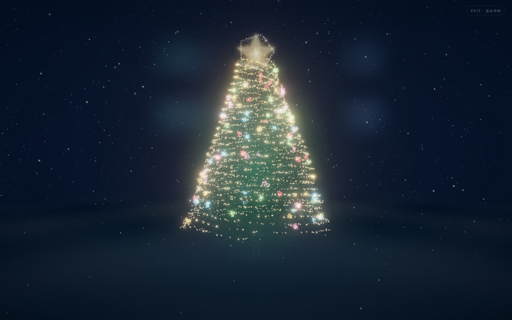
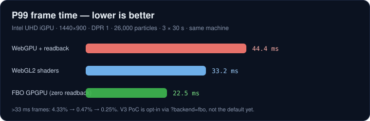
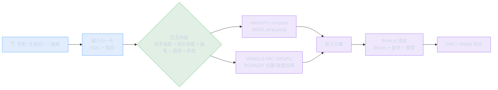

<div align="center">

# 🎄 Aurora Tree Studio

**让散落的光，为你聚成一棵树。**

手势 / 鼠标驱动的 3D 粒子圣诞树工作台 · 26,000 颗粒子 · WebGPU compute + WebGL2 双后端
照片星云球 · 3D 粒子笔迹 · 场景编辑器 · PNG / WebM 导出 · 中英双语

[**🕹 在线体验**](https://2766792840.github.io/christmas-tree-gesture/) ·
[English](README.en.md) ·
[性能实测](app/docs/BENCHMARK.md) ·
[手势链路](app/docs/GESTURE.md) ·
[V3 方案修订](app/docs/V3-R2-REVISIONS.md)

<!-- 第一排：状态与核心指标 -->
[](https://github.com/2766792840/christmas-tree-gesture/actions)
[](https://2766792840.github.io/christmas-tree-gesture/)
[](https://github.com/2766792840/christmas-tree-gesture/releases)
[](LICENSE)
[](#-性能实测)
[](#-技术栈)

<!-- 第二排：技术栈 -->


<!-- 第三排：质量 -->
[](#-质量与验证)
[](#-质量与验证)
[](#-中英双语)

<a href="https://2766792840.github.io/christmas-tree-gesture/">
  
</a>

</div>

## ✨ 这是什么

一棵用 **26,000 颗粒子** 拼出来的圣诞树。手抬起来，它就跟着你动；鼠标划过，光会散开；握拳，树收回去。

不是单文件 demo，而是一个能改、能存、能导出的工程：Vite + TypeScript 骨架、25 个单元测试、6 条 Playwright E2E、CI 与 GitHub Pages 全自动。

## 🎬 先看 30 秒

<div align="center">
  
  <br>
  <sub>净屏模式 · 鼠标当「手」绕树一圈，粒子被拨开后自己落回原位</sub>
</div>

## 🖐 手势速查

对着摄像头比一下就行，不需要任何设备（没有摄像头时鼠标 / 触屏同样能玩）：

| 手势 | 触发 | 效果 |
| :--: | --- | --- |
| ✊ 握拳 | 收成树 | 粒子从任何形态聚回圣诞树 |
| ☝️ 食指 | 爱心 | 同时放一束烟花 |
| ✌️ 两指 | 五角星 | 树上开出一颗星 |
| 🖖 三指 | 雪花 | 拼出六角雪花 |
| 🖐 四指 | 花环 | 环成一个圈 |
| 🖐 五指张开 | 星云 | 粒子散成银河雾 |
| 🤘 拇指 + 小指 | MERRY | 拼出 MERRY 字样 |
| 👌 OK | 许愿 / 收工 | 生成照片许愿球；画笔模式下收笔 |
| 🤏 捏合 | 缩放 | 捏合距离推拉镜头，也能抓照片球 |
| 🙌 双手 | 双指缩放 | 两手距离控制镜头远近 |

> 识别链路是 MediaPipe 21 点 → One Euro 自适应滤波 → 迟滞状态机。参数怎么定的、哪些还没验证，都写在 [GESTURE.md](app/docs/GESTURE.md)。

## 🎨 六种形态，一句话切换

<div align="center">
  
  <br>
  <sub>爱心 · 五角星 · 雪花 · 花环 · 星云 · MERRY　（键盘 1–6 或手势 1–6 指）</sub>
</div>

## 🌈 五套主题

<div align="center">
  
  <br>
  <sub>冰蓝雪夜 · 玫瑰微光 · 赛博全息（另有暖金圣诞、极光幻想）</sub>
</div>

## 🛠 工作室：能改，也能存

<table>
<tr>
<td width="62%"></td>
<td width="38%" valign="top">

- 🎛 输入源：鼠标 ↔ 摄像头手势
- 🖥 渲染后端：自动 / WebGL / WebGPU ping-pong / FBO GPU-resident
- 🎨 主题、形态、粒子数量与流速
- ✨ 亮度、对比度、大小、辉光、照片透明度
- 🌀 力场：排斥 / 吸引 / 涡旋 + 脉冲冲击波
- 💾 预设保存、导出 / 导入 JSON
- 🖼 存图 PNG · 🎥 录制 8 秒 WebM

</td>
</tr>
</table>

## 📱 手机上也能开

<table>
<tr>
<td width="30%"></td>
<td valign="top">

- 触屏就是「手」：拖动改力场中心，双指缩放
- 移动端自动降粒子数、关 WebGPU，走 WebGL2 着色器力场
- 顶栏、画笔条、色板在 390px 宽度下不重叠
- `viewport-fit=cover` + 安全区适配，刘海屏不挡按钮

</td>
</tr>
</table>

## ⚡ 性能实测

<div align="center">
  
</div>

| 后端 | P50 | P95 | P99 | >33ms 帧占比 | 回读 |
| --- | :--: | :--: | :--: | :--: | :--: |
| WebGPU ping-pong + 串行回读（默认） | 22.1 ms | 30.9 ms | 44.4 ms | 4.33% | 约 10.8 Hz |
| WebGL2 着色器力场（对照） | 22.1 ms | 22.4 ms | 33.2 ms | 0.47% | 无 |
| **WebGL2 FBO GPGPU（`?backend=fbo`）** | **22.1 ms** | **22.3 ms** | **22.5 ms** | **0.25%** | **无** |

<sub>Intel UHD 核显 · 1440×900 · DPR 1 · 26,000 粒子 · 3 轮 × 30 秒 · 同一台机器。22.1 ms 接近 45 FPS，**不是 60 FPS**；FBO 只是把长尾抹平，且目前只有这一台设备的数据。</sub>

> 结论来自实测而非推测：先怀疑「回读太频繁」，做 8 槽 staging 环把回读拉到 45 Hz，结果出现过一次 4.7 秒驱动卡死；改成限频 20 Hz 反而 P95 更差。最后回退串行回读 + 顶点插值，并把粒子位置搬进 GPU 浮点纹理（FBO GPGPU），才把 P99 从 44.4 ms 压到 22.5 ms。被否掉的方案、原始数据都在 [BENCHMARK.md](app/docs/BENCHMARK.md)。

## 🧩 技术栈



| 层 | 位置 | 职责 |
| --- | --- | --- |
| 引擎 | `src/app/engine.ts` | Three.js 场景、粒子属性、力场 uniform、照片星球、笔迹、导出 |
| 手势 | `src/core/oneEuro.ts` + `src/core/gestureController.ts` | 自适应滤波、迟滞、候选保持、断手重置（无 `@ts-nocheck`） |
| GPU 物理 | `src/webgpu/compute.ts` / `src/webgl/fboParticles.ts` | WGSL ping-pong / FBO 常驻计算 |
| 编辑器 | `src/ui/editor.ts` | 只通过 `window.__aurora` 改场景，不碰 Three.js |
| 契约 | `src/types/aurora.ts` | 对外 API 的类型定义 |

## 🚀 快速开始

```bash
git clone https://github.com/2766792840/christmas-tree-gesture.git
cd christmas-tree-gesture/app
npm install
npm run dev        # http://127.0.0.1:8782
npm run test       # 25 个单测
npm run e2e        # 6 条 Playwright
npm run build      # 产物在 dist/
```

| 命令 | 作用 |
| --- | --- |
| `npm run typecheck` | `tsc --noEmit`，严格模式 |
| `npm run ci` | typecheck + test + build，与 CI 同一条 |
| `npm run e2e` | 启动预览并跑 6 条视觉 / 行为回归 |

**常用 URL 参数**

| 参数 | 作用 |
| --- | --- |
| `?backend=fbo` | GPU-resident 粒子（零回读，PoC） |
| `?gpu=0` | 强制回落 WebGL2 着色器力场 |
| `?field=1\|2\|3` | 排斥 / 吸引 / 涡旋 |
| `?shape=heart\|star\|flake\|wreath\|galaxy\|text` | 指定形态 |
| `?lang=en\|zh` | 强制语言 |
| `?bench=1` | 打开性能采样桥 `window.__auroraBench` |
| `?interp=0` / `?oe=0` | 关闭顶点插值 / 关闭手势滤波（A/B） |

## 🗺 路线图

| 阶段 | 内容 | 状态 |
| --- | --- | :--: |
| V2.2 | Vite + TS 工程化、分层、i18n、CI、E2E、Pages | ✅ |
| V3-P0 | 基准工具链、诊断 hooks、`benchmark.json` | ✅ |
| V3-P1a | 回读通路改造 → 实测否决 staging 环，改顶点插值 | ✅ |
| V3-P1b | GPU-resident（WebGL2 FBO GPGPU），P99 44.4 → 22.5 ms | ✅ PoC |
| V3-P1c | One Euro + 统一手势状态机 | ✅ 实现 |
| V3-P2 | engine.ts 模块拆分、逐步移除 `@ts-nocheck` | 🚧 |
| V3-P2 | 设备矩阵：独显 / Android / iOS / 30 分钟长稳 | ⏳ |
| V3-P3 | 真实手势轨迹回放集，校准滤波与阈值 | ⏳ |

## 🧪 质量与验证

- **25 个单元测试**：后端仲裁、NDC 换算、预设归一化、One Euro 手势控制器（8 条合成轨迹）
- **6 条 E2E**：启动无报错、非黑屏、形态切换可见变化、`?gpu=0` 回落、语言持久化、WebGPU 后端
- **CI**：push / PR 跑 typecheck + test + build，Pages 自动部署
- **不做的事**：不刷 star、不刷播放量、不编造设备数据；没测过的就写「未测」

## 📄 许可

[MIT](LICENSE) · 用 Three.js、MediaPipe Tasks Vision 与 Vite 构建

<div align="center">
  <br>
  <sub>⭐ 如果这棵树让你想起某个人，点个 star 就好</sub>
</div>

