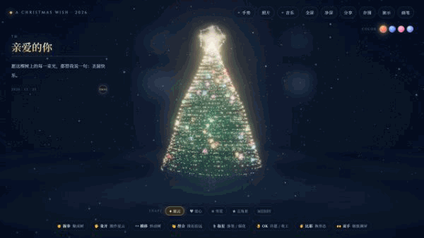
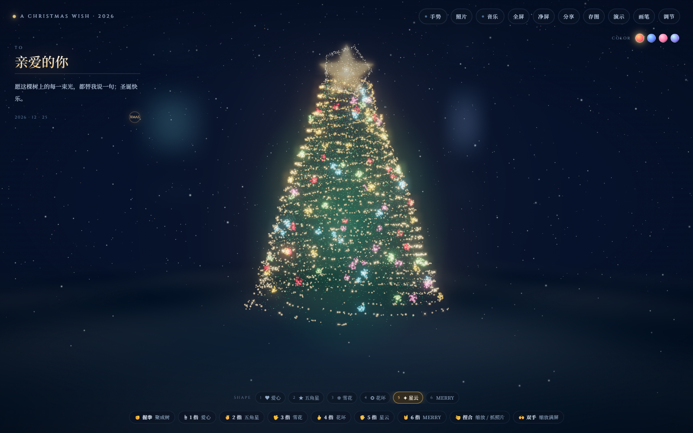
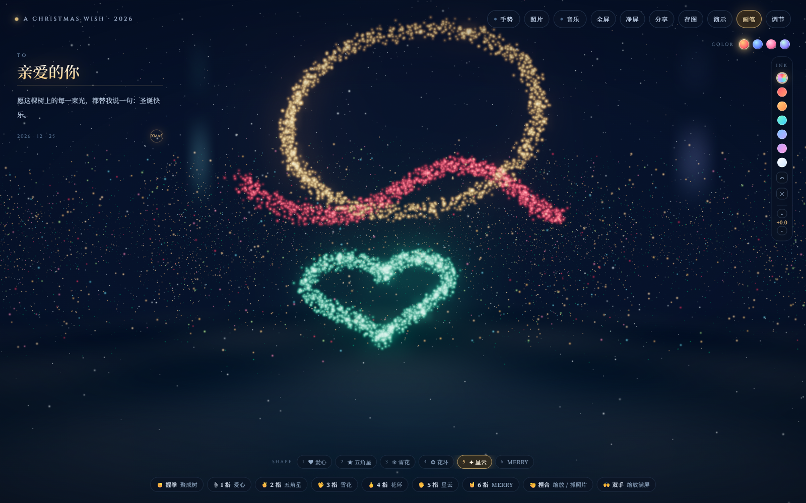
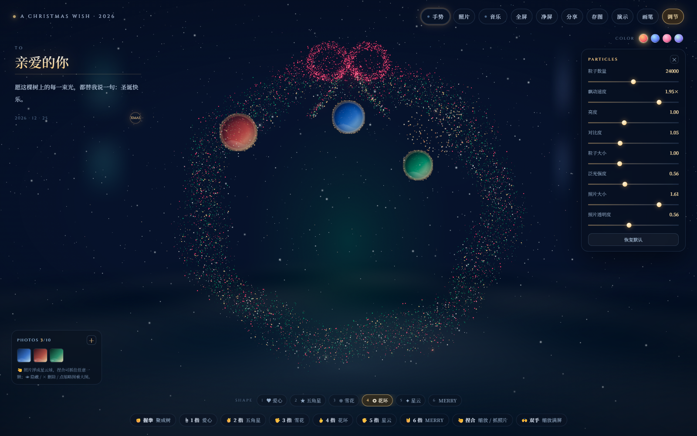

# Christmas Tree · 手势粒子圣诞树

> A single-file WebGL Christmas tree you can **conduct with your bare hands** — 26,000 particles you can tune live, six morphable shapes driven by **1–6 fingers**, 360° free rotation, photos floating as **particle planets** you can **pinch out of the sky**, and a **3D particle brush** that draws with your fingertip.

一个 **单文件** 的圣诞粒子世界：不用任何外部素材、双击即开。伸 1 根手指变爱心、2 根变星星、3 根变雪花、4 根变花环、5 根变星云、6 根变 MERRY；握拳收回成树，捏合推拉镜头、还能把漂浮的照片星球"捏"下来拖着走；指尖落笔写字，画完转着看。

<p align="center">
  <a href="https://2766792840.github.io/christmas-tree-gesture/"><b>🌐 在线体验 · Live Demo</b></a> ·
  <a href="https://github.com/2766792840/christmas-tree-gesture/issues/new/choose">报 Bug</a> ·
  <a href="https://github.com/2766792840/christmas-tree-gesture/discussions">聊想法</a> ·
  <a href="https://github.com/2766792840/christmas-tree-gesture">Star ⭐</a>
</p>

<p align="center">
  
  
  
  
</p>

> ⚠️ 手势需要摄像头权限，浏览器只在 **https 或 127.0.0.1 / localhost** 下才给——所以别直接双击 `file://` 打开，用上面的 Live Demo，或本地起 `tools/serve.ps1`。

<p align="center">
  
</p>

<p>


</p>
<p>


</p>
<p align="center">

</p>

---

## ✨ 它有什么

| 模块 | 说明 |
| --- | --- |
| **粒子树** | 单 `Points` 承载 26,000 粒子（6,000–42,000 可调），自定义 ShaderMaterial；**7 层树冠 + 每层下沿亮边 + 5 道金线螺旋 + 84 颗彩球 + 树顶五角星**，全部同一 draw call |
| **六种形态** | 爱心 / 五角星 / 雪花 / **花环** / 星云 / MERRY 文字，两套 position buffer 做 `mix` 过渡，约 0.65 s 完成形变 |
| **数字手势 1–6** | 伸几根手指就是第几个形态，拇指+小指 = 6；判据用 **3D 世界坐标 + 指节夹角 + 拇指/掌轴夹角**三重校验，拇指贴掌或藏进掌心都不会误判；手势保持 ~0.7 s 生效，换形态 1.5 s 冷却 |
| **粒子调节面板** | 右侧 8 条滑杆实时调 数量 / 飘动速度 / 亮度 / 对比度 / 粒子大小 / 泛光强度 / **照片大小 / 照片透明度**，参数存 localStorage，下次打开还是你的口味 |
| **照片星球** | 最多 10 张，按 Fibonacci 球面均匀分布飘在树周围，缓慢公转 + 呼吸；圆形羽化贴图 + 外圈星尘点阵，看起来像被粒子托住的星球，不再是突兀的方块相框 |
| **照片管理** | 左下缩略图网格可加可删（拖动文件到窗口也能加），每张还能 **隐藏（◉/◌ 眼）**、删除（×）、点开看大图；隐藏后不参与抓取 |
| **照片手势抓取** | 捏合对准某颗照片星球即可抓下来，手掌移动它就跟着走，松手飞回球面轨道 |
| **360° 自由旋转** | 手掌横向平移即匀速转圈（带死区防抖），角度无限累积；鼠标拖拽同样不设限 |
| **手势识别** | MediaPipe HandLandmarker，21 关键点 + `worldLandmarks` 3D 坐标；识别握拳 / 五指 / 1–6 数字 / 捏合 / OK，全部本地推理 |
| **3D 粒子画笔** | 食指作笔，笔迹是 **有体积的粒子簇**，落在与当前视角对齐的平面上；每抬一笔自动换一层（±0.85），滚轮 / ↑↓ / 面板按钮可手动换层，转到任意角度都能继续画，多层笔迹自然交叉成真正的空间结构 |
| **参考层圆环** | 画笔模式显示当前落笔深度的淡色圆环，让你知道自己在三维空间的哪一层画 |
| **相机与氛围** | 泛光（UnrealBloom）、极光雾、飘雪、烟花、八音盒合成音乐（WebAudio，无音频文件） |
| **祝福卡片** | 左上 TO / 祝福文案 / 日期可编辑，`?to=名字` 直接生成给某人的版本 |
| **存图 / 演示** | 一键导出当前画面 PNG；演示模式自动环绕 + 每 8 秒轮换形态 |

## 🖐 手势对照

| 手势 | 效果 |
| --- | --- |
| ☝ **1 指** | 落笔 / 点放烟花；举着约 1.1 s → 爱心 |
| ✌ **2 指** | 五角星 |
| 🖖 **3 指** | 雪花 |
| **4 指**（拇指收进掌心） | 花环 |
| 🖐 **5 指**（拇指翘出去，别贴着手掌） | 星云（可横移旋转） |
| 🤘 **6 指**（拇指 + 小指，其余三指收） | MERRY 文字 |
| ✊ 握拳 | 星尘聚成圣诞树（画笔模式下 = 抬笔） |
| 🤏 捏合 | 推远拉近镜头；对准照片星球时 = 抓住它拖着走，松手归位 |
| 👌 OK | 收下一句心愿（画笔模式下 = 收工，作品保留） |
| 🙌 双手 | 距离决定缩放整个场景 |

> 手势要**保持约 0.7 秒**才判定（连拍 4 帧一致），避免手指过渡那一瞬间误切形态；嫌慢可以在 `handShapeTick()` 里调 `holdMs`。
> 识别不准时看摄像头小窗第二行：`指 11111 · 拇指 62°开 · five` —— 五个 0/1 是四指伸展、后面的角度是拇指与掌轴的夹角，一眼能看出是哪根手指没被判开。

## ⌨️ 快捷键

`空格` 聚散 · `1`–`6` 换形态（1 爱心 / 2 星 / 3 雪花 / 4 花环 / 5 星云 / 6 MERRY） · `p` 画笔 · `z` 撤销一笔 · `i` 示例签名 · `↑`/`↓` 换落笔层 · `l` 锁定自动换层 · `d` 演示 · `e` 存图 · `f` 烟花 · `c` 摄像头 · `m` 静音 · `h` 净屏 · `g` 画廊 · `r` 复位视角

## 🔗 URL 参数（可直接分享）

| 参数 | 作用 |
| --- | --- |
| `?to=Name` | 祝福卡片署名 |
| `?shape=heart\|star\|flake\|wreath\|galaxy\|text` | 直接进入某个形态 |
| `?ink=1` | 自动打开画笔并画两笔示例（红 + 青） |
| `?spread=0~1` | 指定聚散程度 |
| `?demo=1` | 自动挂 3 张示例照片 + 形态轮播 |
| `?debug=1` | 暴露 `window.__xmas`（`analyze()` / `TUNE` / `PHOTOGRAB` 等），方便调试与自动化测试 |
| `?show=1` | 跳过开场引导 |
| `?perf=0` | 关闭帧率自动降档（截图/演示时用） |
| `?rot=1.2` | 指定初始旋转角（rad） |
| `?hide=sky,snow,fw,treeGroup` | 调试用，隐藏指定图层 |

## 🚀 开始

**在线体验（推荐）**：GitHub Pages 部署后是 `https://`，摄像头可直接使用。

**本地运行**：`file://` 打开会被浏览器禁用摄像头，请用任意本地服务：

```bash
python -m http.server 8765
# 然后访问 http://127.0.0.1:8765/
```

Windows 用户也可以直接双击 `tools/打开本地预览.cmd`（内置 PowerShell 静态服务，不依赖 Python，会顺带打开浏览器）。

首次加载需要联网：Three.js r160、MediaPipe tasks-vision 与手部模型走 CDN。没有摄像头也能玩——鼠标拖拽旋转、滚轮缩放、点击放烟花、按住左键直接用鼠标画。

## 🧠 实现要点

- **一个 Points 装下整棵树**：位置、颜色、尺寸、类型全部走 attribute，`mix(aTree, shape, uSpread)` 在做形变，避免多对象带来的 draw call。
- **聚散是 shader 里的插值**：`uSpread` 从 0 到 1，粒子从树形飞到形态位置，同时叠加 `sin/cos` 漂移，散开时不呆板。
- **进阶手势判据**：区分「捏合」与「握拳」不看拇指食指距离（握拳时指尖反而更近），而是三条一起判：`pinchD < 0.68`（指尖贴合）、拇指尖离开手腕 > 0.9 掌宽（排除了拇指缩在拳里的情况）、食指指尖离开手腕 > 1.05 掌宽（排除握拳）。
- **五指为什么会被判成四指**：旧版只看「拇指尖是否比指间关节更远离手腕」，伸手到大屏前这个比值会掉到 1.2 以下；更要命的是「拇指侧向外撇」用的是图片 x 轴，左手 / 镜像画面直接失效。现在拇指判定改成三条正交判据：**IP 关节夹角**（`cos < -0.30`，即基本伸直）+ **拇指走向与掌轴夹角 > 30°** + **拇指尖离开掌心**，并把 MediaPipe 的 `worldLandmarks`（米制 3D 坐标）作为平行判据——手怎么转，角度和距离都不变，5 指和 6 指（沙卡）因此稳定分开。
- **形态切换要「举住」**：手势必须先连续 4 帧判定一致，再保持 ~0.7 s 才换形态，且距上次换形态 1.5 s 内不再触发——手指从 1 伸到 5 的过渡帧不会连着切五次。
- **调滑杆不重建场景**：亮度 / 对比度 / 大小 / 速度 / 照片大小 / 照片透明度只改 uniform 或 sprite 属性，粒子数量才重建 geometry；重建时把照片组、笔画组与它们的 uniform 引用迁移到新树，当前形态一并重算，画面不闪。
- **树形是「分层 + 螺旋」算出来的**：`envAt(h)` 给出 7 层阶梯式半径包络（每层下沿微外张形成裙边），树冠沿层分布、外侧更密；另外 5 道金线用 `h × 2π × 5.2` 的螺旋绕在包络表面，每层下沿还有一圈亮边，所以转起来一眼能看出层次与缠绕感。
- **照片抓取用屏幕空间命中**：把每张照片投影到 NDC 与指尖比距离（阈值 0.13），比三维距离稳得多；抓取期间锁住镜头缩放，松手用指数阻尼飞回球面轨道。
- **笔迹是 3D 的**：落笔平面按「屏幕射线 × 当前视角前方某一深度」求交，再转进树的局部坐标——所以把手转到任何角度，笔还在你眼前这一层；深度由手掌远近微调、由抬笔自动递进（±0.85 往返），同一视角也能画出层层叠叠的隧道，转 90° 再画就是另一张"纸"，两张纸交叉便成了空间结构。
- **粒子的体积感**：每个采样点扩成一簇（主点 + 1–2 个随机方向伴点），笔迹因此有厚度与散边，而不是一条扁平的点串。
- **性能分档**：连续两次采样 fps < 42 才降一档（1.5 → 1.15 → 1.0，最低档关 bloom），避免瞬时抖动误降。

## 📁 目录

```
christmas-tree-gesture/
├── index.html                # 全部内容（单文件，约 143 KB）
├── README.md
├── TESTING.md                # 测试报告：用例、手势回归数据、已知限制
├── SKILL.md                  # 技能包说明：能力、参数、二次开发接口
├── CONTRIBUTING.md           # 共建指南：怎么报 bug、怎么提 PR
├── LICENSE                   # MIT
├── demo.gif                  # 12 秒手势演示：比耶变形态 + 指尖画签名
├── 01-tree.png ~ 05-panel.png  # 截图（含新版花环 + 双面板）
├── tools/serve.ps1           # Windows 本地静态服务
├── tools/打开本地预览.cmd
└── .github/ISSUE_TEMPLATE/   # 报 Bug / 提需求 模板（空白 Issue 已关闭）
```

## 🤝 共建

这个项目是**边玩边改出来的**，已知还有些没磨平的地方（见 [TESTING.md](TESTING.md) 第 5、7 节，尤其真实摄像头下的手感、不同机型的手势阈值）。欢迎直接提 Issue 或 PR：

- 报 bug 请带上：浏览器版本、手势、你看到的画面（截图/录屏最好）、控制台报错；
- 想改视觉/加形态，`shapePoint()` 里加一个分支就行，PR 里说明改了什么；
- 不确定算不算 bug 也可以先开 Discussion 聊。

详见 [CONTRIBUTING.md](CONTRIBUTING.md)。第一次参与开源也完全没问题，标 `good first issue` 的都是上手就能改的。

## 🧩 改造它

打开 `index.html`，所有可调参数集中在几处：`H=11 / R=4.6`（树高与半径）、`TREE_N`（初始粒子数，滑杆重建后会被改写）、`TUNE_DEFAULT`（滑杆默认值：数量 / 速度 / 亮度 / 对比度 / 大小 / 泛光 / 照片大小 / 照片透明度）、`SHAPE_ORDER`（形态顺序，同时也是键盘 1–6 与数字手势的映射）、`PHOTO_SLOTS` 与 `PHOTO_SPHERE`（照片球面分布：改 `PHOTO_MAX` 就自动重排 Fibonacci 球）、`INK_MAX`（画笔粒子上限）、`theme()`（配色主题）。形态生成函数是 `shapePoint(name, i, out, p)`，想要新造型就加一个分支，再把名字加进 `SHAPE_ORDER / SHAPE_LABEL / FINGER_SHAPE`；想改树的外观就动 `buildTree()` 里的 `TIERS` 与 `envAt()`。

## 📌 兼容性

Chrome / Edge / 较新的 Firefox、Safari 可用；手势需要 WebGL2 + 摄像头权限，识别全程在本地，不上传任何画面。

## ⭐ 如果它让你停了一秒

点个 Star 就是最好的支持；也欢迎 fork 出你自己的版本——换配色、换形态、换成新年主题都行。

## License

MIT © 2026 Christmas Tree contributors

其他去处：[Wiki](https://github.com/2766792840/christmas-tree-gesture/wiki)（玩法与已知问题的长文版）· [Discussions](https://github.com/2766792840/christmas-tree-gesture/discussions)（随便聊）· [在线体验](https://2766792840.github.io/christmas-tree-gesture/)

