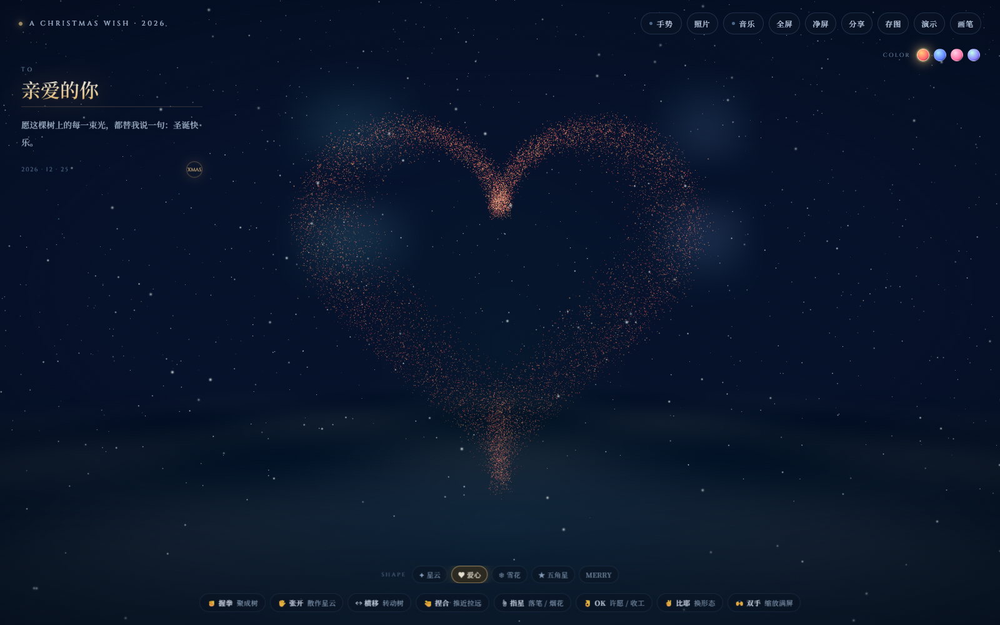
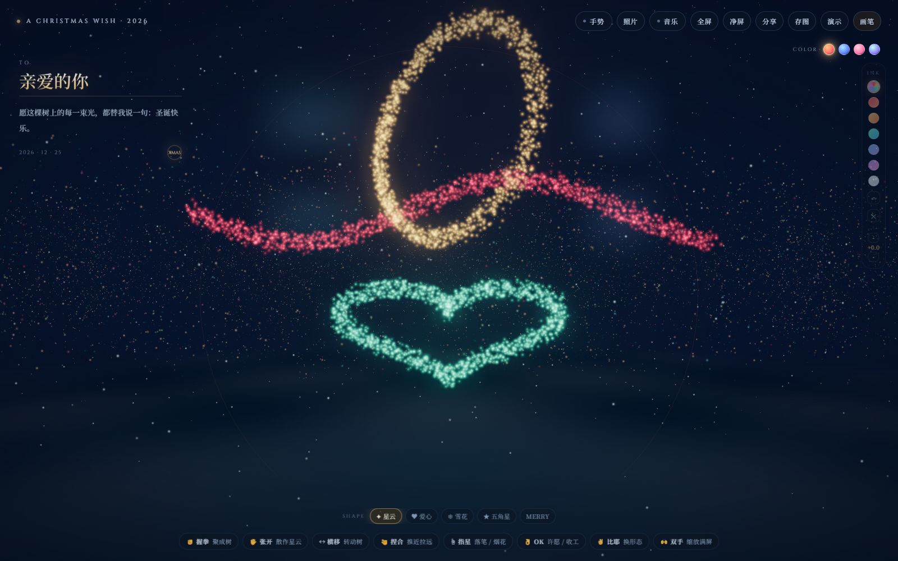

# Christmas Tree · 手势粒子圣诞树

> A single-file WebGL Christmas tree you can **conduct with your bare hands** — 26,000 particles, five morphable shapes, 360° free rotation, and a **3D particle brush** that draws with your fingertip.

一个 **单文件** 的圣诞粒子世界：不用任何外部素材、双击即开。握拳聚成树、张开散作星云、手掌横移转整圈、指尖落笔写字，画完还能用手势继续转着看。

<p align="center">
  <a href="https://2766792840.github.io/christmas-tree-gesture/"><b>🌐 在线体验 · Live Demo</b></a> ·
  <a href="https://github.com/2766792840/christmas-tree-gesture/issues/new/choose">报 Bug</a> ·
  <a href="https://github.com/2766792840/christmas-tree-gesture/discussions">聊想法</a> ·
  <a href="https://github.com/2766792840/christmas-tree-gesture">Star ⭐</a>
</p>

<p align="center">
  
  
  
  
</p>

> ⚠️ 手势需要摄像头权限，浏览器只在 **https 或 127.0.0.1 / localhost** 下才给——所以别直接双击 `file://` 打开，用上面的 Live Demo，或本地起 `tools/serve.ps1`。

<p>


</p>
<p>


</p>

---

## ✨ 它有什么

| 模块 | 说明 |
| --- | --- |
| **粒子树** | 单 `Points` 承载 26,000 粒子，自定义 ShaderMaterial；树体、彩球、灯带、雪地在同一 draw call 内 |
| **五种形态** | 星云 / 爱心 / 雪花 / 五角星 / MERRY 文字，两套 position buffer 做 `mix` 过渡，约 0.65 s 完成形变 |
| **360° 自由旋转** | 手掌横向平移即匀速转圈（带死区防抖），角度无限累积；鼠标拖拽同样不设限 |
| **手势识别** | MediaPipe HandLandmarker，21 关键点；识别握拳 / 张开 / 捏合 / OK / 比耶 / 食指，全部本地推理 |
| **3D 粒子画笔** | 食指作笔，笔迹是 **有体积的粒子簇**，落在与当前视角对齐的平面上；每抬一笔自动换一层（±0.85），滚轮 / ↑↓ / 面板按钮可手动换层，转到任意角度都能继续画，多层笔迹自然交叉成真正的空间结构 |
| **参考层圆环** | 画笔模式显示当前落笔深度的淡色圆环，让你知道自己在三维空间的哪一层画 |
| **相机与氛围** | 泛光（UnrealBloom）、极光雾、飘雪、烟花、八音盒合成音乐（WebAudio，无音频文件） |
| **祝福卡片** | 左上 TO / 祝福文案 / 日期可编辑，`?to=名字` 直接生成给某人的版本 |
| **存图 / 演示** | 一键导出当前画面 PNG；演示模式自动环绕 + 每 8 秒轮换形态 |

## 🖐 手势对照

| 手势 | 效果 |
| --- | --- |
| ✊ 握拳 | 星尘聚成圣诞树（画笔模式下 = 抬笔） |
| ✋ 张开手掌 | 树散作旋转星云 |
| ↔ 手掌横向平移 | 整棵树 360° 旋转，想转几圈转几圈 |
| 🤏 捏合 / OK | 推远或拉近镜头（行程按拇指外伸度平滑映射） |
| ☝ 食指 | 点放烟花（画笔模式下 = 落笔） |
| ✌ 比耶 | 切换到下一种粒子形态（1.9 s 冷却）；画笔模式下 = 换下一种笔色 |
| 👌 OK | 收下一句心愿（画笔模式下 = 收工，作品保留） |
| 🙌 双手 | 张合缩放整个场景 |

## ⌨️ 快捷键

`空格` 聚散 · `1`–`5` 换形态 · `p` 画笔 · `z` 撤销一笔 · `i` 示例签名 · `↑`/`↓` 换落笔层 · `l` 锁定自动换层 · `d` 演示 · `e` 存图 · `f` 烟花 · `c` 摄像头 · `m` 静音 · `h` 净屏 · `g` 画廊 · `r` 复位视角

## 🔗 URL 参数（可直接分享）

| 参数 | 作用 |
| --- | --- |
| `?to=Name` | 祝福卡片署名 |
| `?shape=heart\|flake\|star\|text\|galaxy` | 直接进入某个形态 |
| `?ink=1` | 自动打开画笔并画两笔示例（红 + 青） |
| `?spread=0~1` | 指定聚散程度 |
| `?show=1` | 跳过开场引导 |
| `?perf=0` | 关闭帧率自动降档（截图/演示时用） |
| `?rot=1.2` | 指定初始旋转角（rad） |
| `?hide=sky,snow,fw,treeGroup` | 调试用，隐藏指定图层 |

## 🚀 开始

**在线体验（推荐）**：GitHub Pages 部署后是 `https://`，摄像头可直接使用。

**本地运行**：`file://` 打开会被浏览器禁用摄像头，请用任意本地服务：

```bash
python -m http.server 8765
# 然后访问 http://127.0.0.1:8765/
```

Windows 用户也可以直接双击 `tools/打开本地预览.cmd`（内置 PowerShell 静态服务，不依赖 Python，会顺带打开浏览器）。

首次加载需要联网：Three.js r160、MediaPipe tasks-vision 与手部模型走 CDN。没有摄像头也能玩——鼠标拖拽旋转、滚轮缩放、点击放烟花、按住左键直接用鼠标画。

## 🧠 实现要点

- **一个 Points 装下整棵树**：位置、颜色、尺寸、类型全部走 attribute，`mix(aTree, shape, uSpread)` 在做形变，避免多对象带来的 draw call。
- **聚散是 shader 里的插值**：`uSpread` 从 0 到 1，粒子从树形飞到形态位置，同时叠加 `sin/cos` 漂移，散开时不呆板。
- **进阶手势判据**：区分「捏合」与「握拳」的关键不是拇指食指距离（握拳时反而更近），而是 **拇指外伸度** `thumbAway = d(拇指尖, 小指根)/掌宽`。捏合要求 `pinchD < 0.68 && thumbAway > 1.55`。
- **笔迹是 3D 的**：落笔平面按「屏幕射线 × 当前视角前方某一深度」求交，再转进树的局部坐标——所以把手转到任何角度，笔还在你眼前这一层；深度由手掌远近微调、由抬笔自动递进（±0.85 往返），同一视角也能画出层层叠叠的隧道，转 90° 再画就是另一张"纸"，两张纸交叉便成了空间结构。
- **粒子的体积感**：每个采样点扩成一簇（主点 + 1–2 个随机方向伴点），笔迹因此有厚度与散边，而不是一条扁平的点串。
- **性能分档**：连续两次采样 fps < 42 才降一档（1.5 → 1.15 → 1.0，最低档关 bloom），避免瞬时抖动误降。

## 📁 目录

```
christmas-tree-gesture/
├── index.html                # 全部内容（单文件，约 119 KB）
├── README.md
├── TESTING.md                # 测试报告：用例、手势回归数据、已知限制
├── SKILL.md                  # 技能包说明：能力、参数、二次开发接口
├── CONTRIBUTING.md           # 共建指南：怎么报 bug、怎么提 PR
├── LICENSE                   # MIT
├── 01-tree.png ~ 04-ink-3d.png  # 截图
├── tools/serve.ps1           # Windows 本地静态服务
├── tools/打开本地预览.cmd
└── .github/ISSUE_TEMPLATE/   # 报 Bug / 提需求 模板（空白 Issue 已关闭）
```

## 🤝 共建

这个项目是**边玩边改出来的**，已知还有些没磨平的地方（见 [TESTING.md](TESTING.md) 第 5、7 节，尤其真实摄像头下的手感、不同机型的手势阈值）。欢迎直接提 Issue 或 PR：

- 报 bug 请带上：浏览器版本、手势、你看到的画面（截图/录屏最好）、控制台报错；
- 想改视觉/加形态，`shapePoint()` 里加一个分支就行，PR 里说明改了什么；
- 不确定算不算 bug 也可以先开 Discussion 聊。

详见 [CONTRIBUTING.md](CONTRIBUTING.md)。第一次参与开源也完全没问题，标 `good first issue` 的都是上手就能改的。

## 🧩 改造它

打开 `index.html`，所有可调参数集中在几处：`H=11 / R=4.6`（树高与半径）、`TREE_N`（粒子数）、`SHAPE_ORDER`（形态顺序）、`INK_MAX`（画笔粒子上限）、`theme()`（配色主题）。形态生成函数是 `shapePoint(name, i, out, p)`，想要新造型就加一个分支。

## 📌 兼容性

Chrome / Edge / 较新的 Firefox、Safari 可用；手势需要 WebGL2 + 摄像头权限，识别全程在本地，不上传任何画面。

## ⭐ 如果它让你停了一秒

点个 Star 就是最好的支持；也欢迎 fork 出你自己的版本——换配色、换形态、换成新年主题都行。

## License

MIT © 2026 Christmas Tree contributors

其他去处：[Wiki](https://github.com/2766792840/christmas-tree-gesture/wiki)（玩法与已知问题的长文版）· [Discussions](https://github.com/2766792840/christmas-tree-gesture/discussions)（随便聊）· [在线体验](https://2766792840.github.io/christmas-tree-gesture/)
