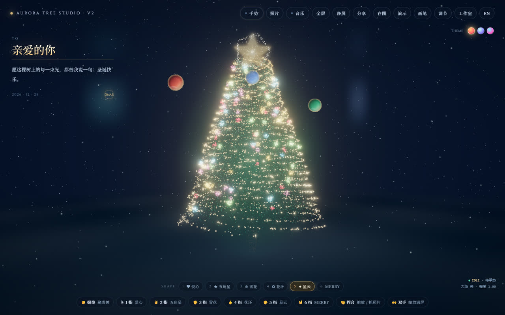
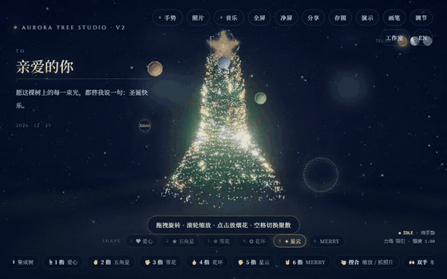
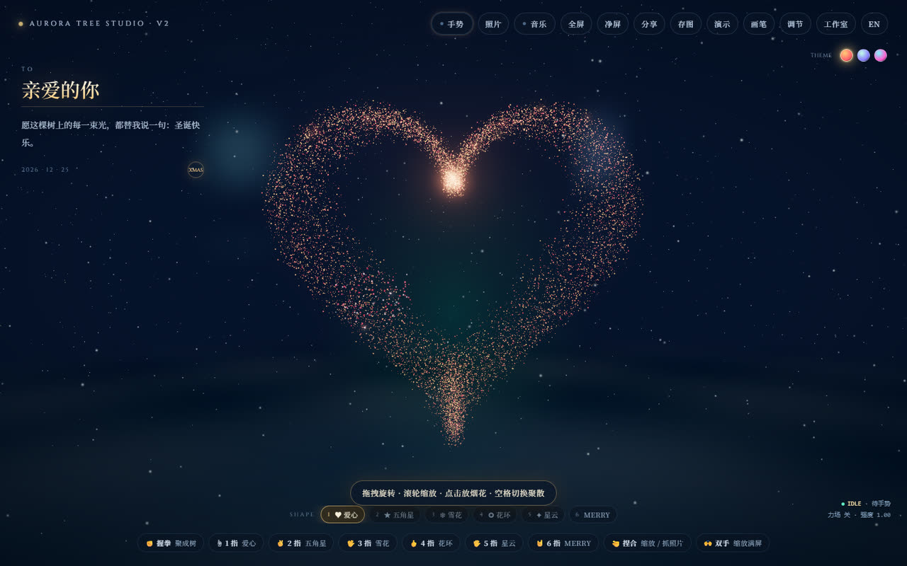
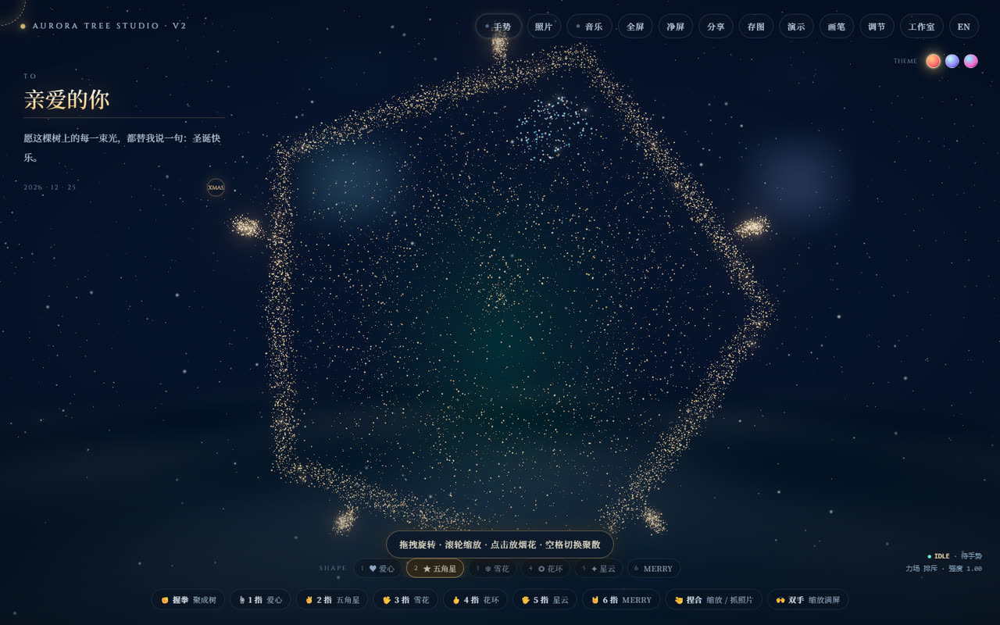
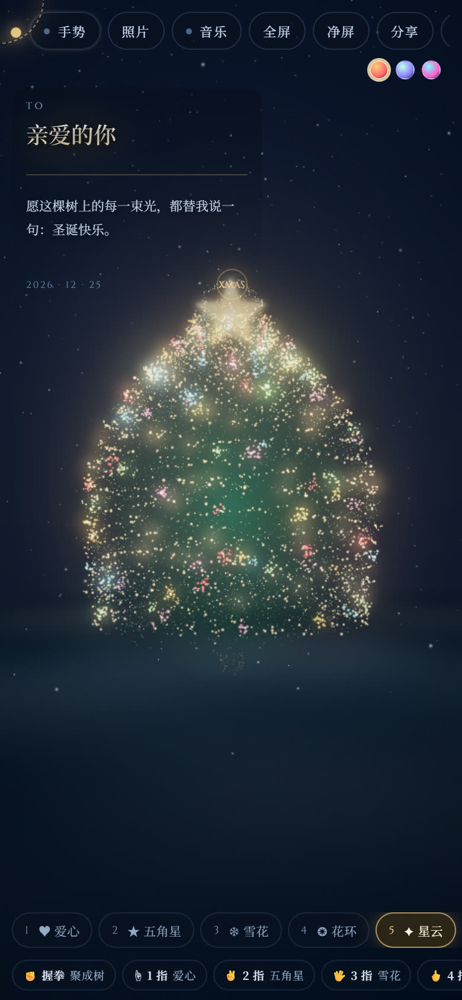

<div align="center">
  
</div>

<h1 align="center">🎄 Aurora Tree Studio <sub>V2.2</sub></h1>

<p align="center">
  用摄像头手势或鼠标，把 26,000 颗星尘搓成一棵会呼吸的圣诞树。<br>
  浏览器里跑，不需要显卡驱动折腾，打开就能玩。
</p>

<p align="center">
  <a href="https://2766792840.github.io/christmas-tree-gesture/"></a>
  <a href="https://github.com/2766792840/christmas-tree-gesture/releases/tag/v2.2.0"></a>
  <a href="https://github.com/2766792840/christmas-tree-gesture/actions/workflows/ci.yml"></a>
</p>

<p align="center">
  
  
  
  
  
  
</p>

<p align="center">
  <b>中文</b> · <a href="README.en.md">English</a> · <a href="https://2766792840.github.io/christmas-tree-gesture/">在线体验</a> · <a href="legacy/v1/">V1 归档</a>
</p>

---

## 🎬 先看八秒

<p align="center">
  
</p>

<p align="center"><sub>鼠标绕一圈，粒子被力场拖着走，松手后自己弹回树的形状 —— 这段是真机录屏，不是剪辑特效。</sub></p>

## ✨ 能玩到什么

- 🖐 **手势或鼠标，二选一**：有摄像头就举手做手势，没有摄像头鼠标就是你的手——移动指针控制力场中心，按住左键「握紧」，力场强度 ×1.45。
- 🪄 **26,000 颗粒子**：不是贴图，是 GPU 上的点精灵；每一颗都有自己的种子、颜色、尺寸与回位弹簧。
- 💛 **六种形态**：爱心、五角星、雪花、花环、星云、MERRY，按 `1`–`6` 或伸出对应手指数一键切换，切换后粒子自己「落」回新形状。
- 🖼 **照片记忆球**：把照片拖进场景变成绕树公转的星球，可以调大小、透明度、单张显隐。
- 🖌 **3D 笔迹**：在空间里画发光轨迹，写完还能擦。
- 🎛 **完整场景编辑器**：主题、形态、粒子参数、力场、层级、预设、导出，全在一个抽屉里。
- 📦 **作品带得走**：存 PNG 快照，或录 8 秒 WebM。
- 🌐 **中英双语**：`EN / 中文` 一键切换，选择记在 localStorage。

## 📸 界面与形态

<table>
  <tr>
    <td align="center"><br><sub><b>爱心</b> · 伸出 1 指</sub></td>
    <td align="center"><br><sub><b>五角星</b> · 伸出 2 指</sub></td>
  </tr>
  <tr>
    <td align="center"><br><sub><b>场景编辑器</b> · 输入源 / 后端 / 主题 / 粒子 / 力场</sub></td>
    <td align="center"><br><sub><b>English UI</b> · 同一套场景，文案与手势条同步切换</sub></td>
  </tr>
</table>

<p align="center">
  <br>
  <sub>📱 手机竖屏：镜头会按屏幕比例自动后退，整棵树都在画面里</sub>
</p>

## 🧠 它是怎么跑起来的

渲染还是 three.js 的 WebGL，WebGPU 只接管粒子物理——这样材质不用整体重写成 TSL 节点，也能吃到 compute 的算力。

- `src/webgpu/compute.ts` 里的 `PingPongParticles` 持有 `base`（目标位置 + 种子，vec4）、`posA/posB`、`velA/velB` 三组 storage buffer，两个 bind group 互指，逐帧交替读写，这就是 ping-pong。
- WGSL kernel 每帧做：弹簧回位（换形态后粒子自己落回去）、手掌排斥 / 吸引（按种子给不同 reach，吸引留在球壳上）、涡旋、脉冲冲击波、指数阻尼。
- 算完 `copyBufferToBuffer` 到 staging，异步 `mapAsync` 读回，压成 vec3 喂给 `aPhys` 顶点属性；`uGpu > 0.5` 时着色器直接用 `aPhys` 当位置，关掉内建的力场块。
- 后端仲裁在 `src/core/backend.ts`：桌面 + 有 WebGPU 才自动启用；移动端、没有 WebGPU、`?gpu=0` 都回落 WebGL2 着色器力场。编辑器里可手动切换，HUD 右下角实时显示当前后端。
- 实测（Intel Gen-12lp 核显 / 26k 粒子）：WebGPU 约 45–47 fps，WebGL2 约 46 fps，切换后没有明显掉帧。

## 🚀 本地跑起来

```bash
cd app
npm install
npm run dev        # http://127.0.0.1:8782
npm run typecheck  # tsc --noEmit
npm run test       # vitest，17 个用例
npm run build      # 产物在 app/dist/
npm run preview    # 预览构建产物（8783）
npm run ci         # typecheck + test + build，CI 里跑的就是这条
```

改完源码把 `app/dist/index.html` 与 `app/dist/assets/` 覆盖到仓库根目录，线上页面就更新了。构建产物不依赖 importmap，可以直接丢进任意静态站点。

想自己重拍本文档里的截图与动图：

```bash
cd app
npm run build && npx vite preview --port 8783   # 另开一个终端
node scripts/capture.mjs                         # 输出到 ../docs/screenshots/
```

## 🧪 测试与 CI

<p>
  
  
  
</p>

`src/core/*.test.ts` 覆盖三块最容易静默出错的纯逻辑：后端仲裁、NDC 换算与强度步进、预设归一化与序列化往返。

<details>
<summary>🧷 17 个单测 + 6 个 E2E 分别断言了什么</summary>

- `backend.test.ts`（4）：手动 / auto / 无 GPU / 移动端的仲裁结果与理由文案。
- `pointer.test.ts`（7）：NDC 换算（中心、四角、越界夹取、尺寸为 0 不产生 Infinity）、力场强度步进与 0–2 夹取。
- `presets.test.ts`（6）：预设归一化、坏 JSON / 数组输入返回 null、序列化往返。
- E2E 不锁像素基线（不同 GPU 必然不同），而是四条跨机器稳定的断言：截图非黑屏、切形态前后像素差异 > 2%、页面零 `pageerror` / console error / WebGPU `used in submit while mapped` 警告；外加 `?gpu=0` 必须回落 WebGL2、语言切换写入 localStorage、有 WebGPU 时后端必须是 ping-pong（CI 无 GPU 自动 skip）。

</details>

`.github/workflows/ci.yml`：push main、PR、手动触发；Node 22、`npm ci`、typecheck、test、build，再跑 Playwright E2E，失败时上传 `playwright-report/` 与 `test-results/`。

## 🗂 仓库结构

```
index.html          # 线上页面（已构建，GitHub Pages 读这里）
assets/             # 已构建的 js / css
app/                # Vite + TypeScript 工程源码，开发与构建都在这里
legacy/v1/          # V1 单文件版归档
docs/screenshots/   # README 用的截图与动图（由 app/scripts/capture.mjs 生成）
```

```
app/index.html              # 只留 DOM / 样式，没有内联 3000 行脚本
app/src/main.ts             # 启动：挂编辑器 → 挂鼠标手势 → 探测摄像头
app/src/app/engine.ts       # 渲染内核（three.js 场景、粒子、着色器、手势 FSM、导出）
app/src/webgpu/compute.ts   # WebGPU ping-pong 粒子物理（WGSL kernel）
app/src/types/aurora.ts     # 引擎对外 API 的类型契约（window.__aurora）
app/src/core/presets.ts     # 预设归一化 / 解析 / 序列化
app/src/core/pointer.ts     # NDC 换算、力场强度步进
app/src/core/backend.ts     # 渲染后端仲裁：auto / webgl / webgpu
app/src/core/pointerHand.ts # 无摄像头时「鼠标当手」
app/src/ui/editor.ts        # 场景编辑器（只通过 window.__aurora 改场景）
app/src/ui/i18n.ts          # 中英文案字典 + 拼接句规则 + 语言探测
app/src/ui/langDom.ts       # DOM 文本节点翻译、语言开关、动态内容兜底
app/src/dev/errorScreen.ts  # 运行时报错落屏
```

**分层约定**：引擎独占 Three.js；编辑器只调 `window.__aurora` 的语义 API（`setTheme` / `setShape` / `tune` / `setField` / `photos` / `layers` / `preset` / `snapshot` / `record`）；输入层只写归一化坐标，世界坐标换算留给引擎。

## ⌨️ 没有摄像头也能玩

| 操作 | 效果 |
| --- | --- |
| 移动指针 | 手掌位置（力场中心） |
| 按住左键 | 握紧，力场强度 ×1.45 |
| `Shift` + 滚轮 | 调力场强度（力场关着时自动切到吸引） |
| `1`–`6` | 六种形态 |
| `G` | 切力场 |
| 空格 | 脉冲冲击波 |
| `E` | 开关编辑器 |

**URL 参数**：`?field=1|2|3`（排斥/吸引/涡旋）、`?fieldSim=1`（力场自动巡演）、`?gpu=0`（强制 WebGL）、`?demo=1`（演示照片）、`?shape=heart|star|flake|wreath|nebula|merry`、`?lang=en|zh`、`?debug=1`。

## 🎛 编辑器完整能力

<details>
<summary>展开分组清单</summary>

| 分组 | 内容 |
| --- | --- |
| 输入源 | 鼠标 / 触屏 ↔ 摄像头手势，自动检测无摄像头并切鼠标模式 |
| 渲染后端 | 自动 / WebGL 着色器 / WebGPU ping-pong + 运行状态 |
| 主题 | 暖金圣诞 / 冰蓝雪夜 / 玫瑰微光 / 极光幻想 / 赛博全息 |
| 形态 | 爱心 / 五角星 / 雪花 / 花环 / 星云 / MERRY（手势 1–6 指同源） |
| 粒子 | 数量、流速、亮度、对比度、大小、辉光、照片尺寸、照片透明度 |
| 力场 | 关 / 排斥 / 吸引 / 涡旋 + 强度 + 脉冲冲击波 + 演示动效 |
| 照片 | 缩略图列表、单张隐藏/显示、删除、添加（多选） |
| 层级 | 粒子树、树顶星、光晕、照片、星空、飘雪、极光、银河雾、地面、雪地、笔迹、烟花 |
| 预设 | 保存本机、载入、导出 JSON、导入 JSON、粘贴 JSON 直接应用 |
| 导出 | 存图 PNG、录制 8 秒 WebM |

</details>

## 📌 还没做完（写在这，不假装做了）

- 用鼠标拖拽抓取照片星球：照片抓取目前仍依赖手部关键点。
- 纯 WebGPU 渲染管线：现在是 compute + 回读 + WebGL 渲染，材质没有迁到 TSL。
- `engine.ts` 拆模块并补内部类型：现在对外签名被 `AuroraApi` 卡住，对内整体仍是 `// @ts-nocheck`。
- 锁死像素基线的视觉回归：现在只有跨机器稳定的三条断言，不锁具体像素。

## 📄 License

MIT © 2026 2766792840 · 旧版单文件页面留在 [`legacy/v1/`](legacy/v1/)，不影响线上。

<p align="center"><sub>🎄 如果这棵树点亮了你，点个 ⭐ 让它继续亮着。</sub></p>
